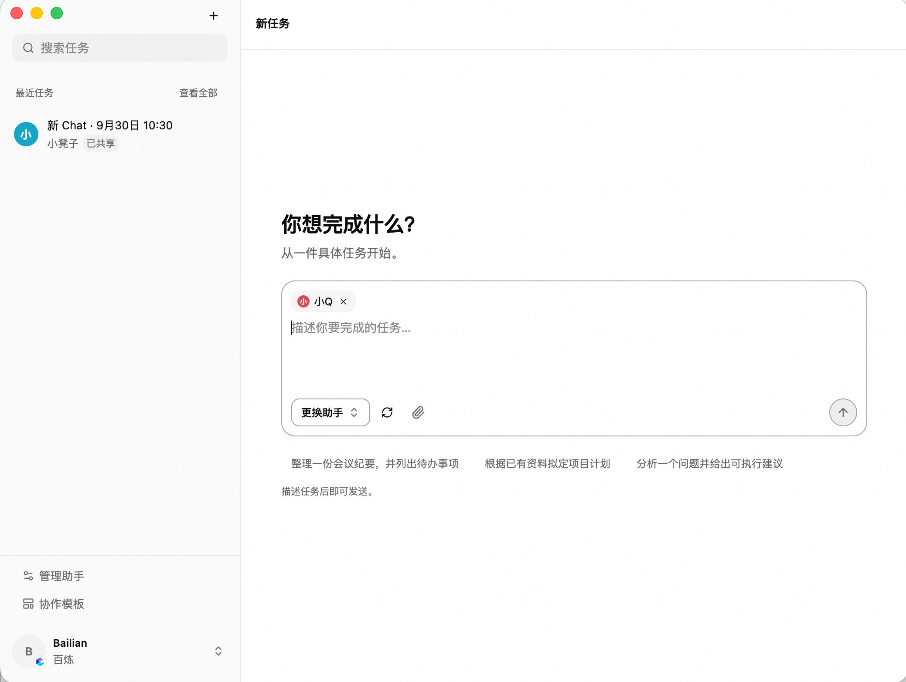
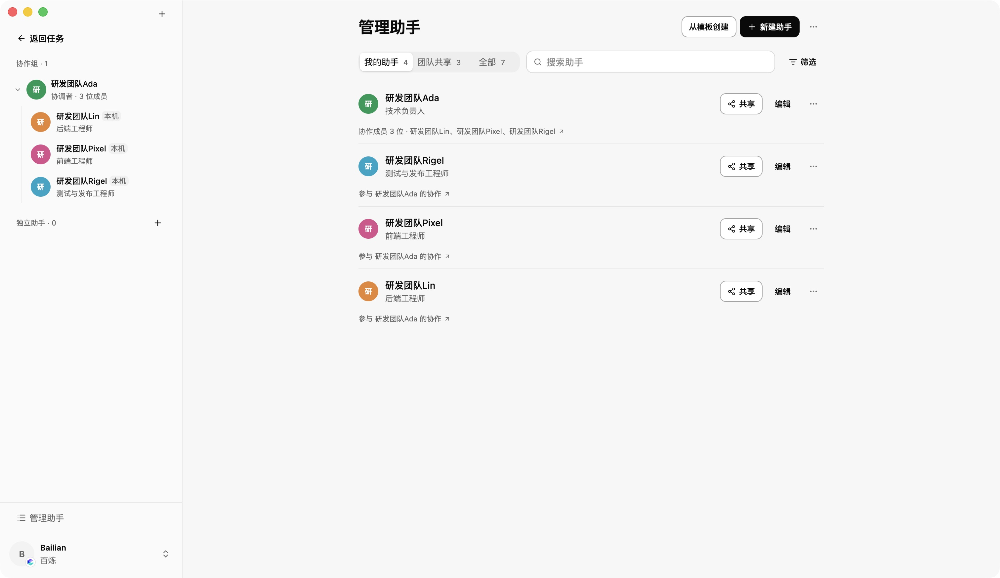
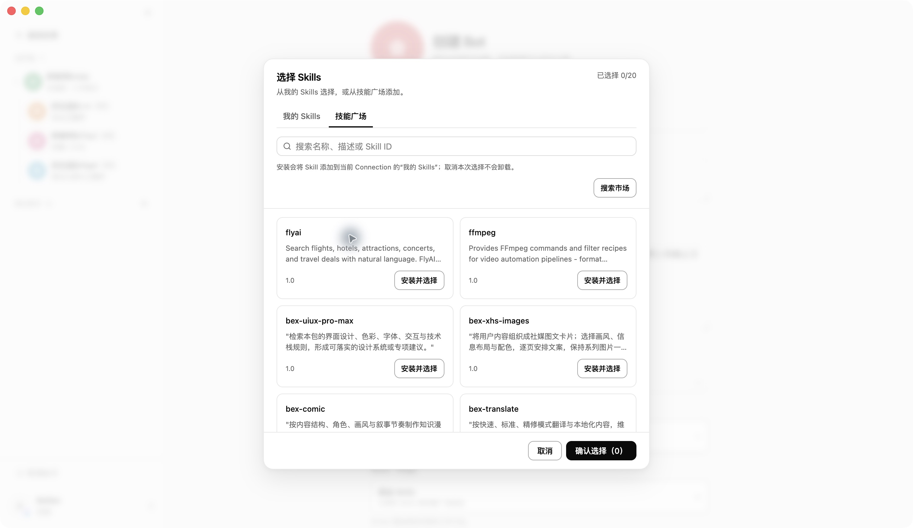
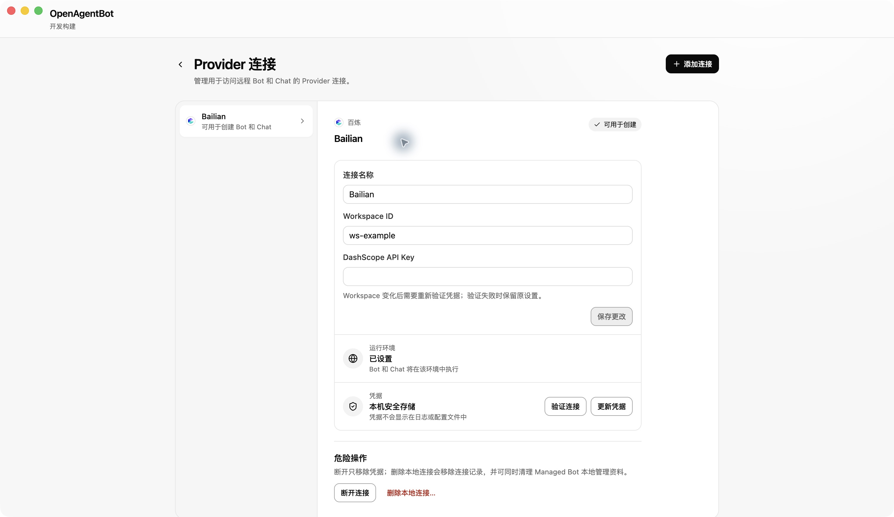
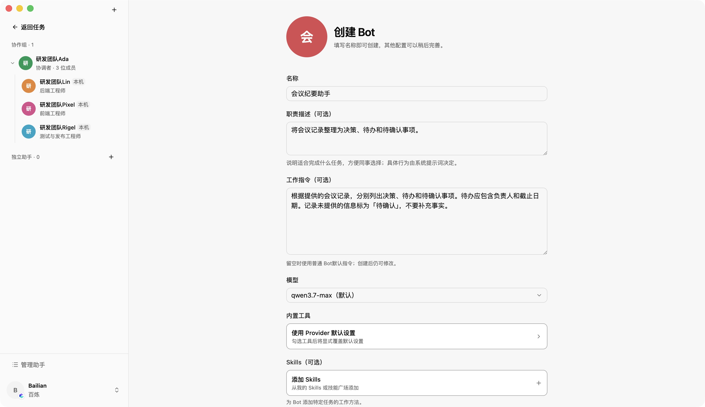
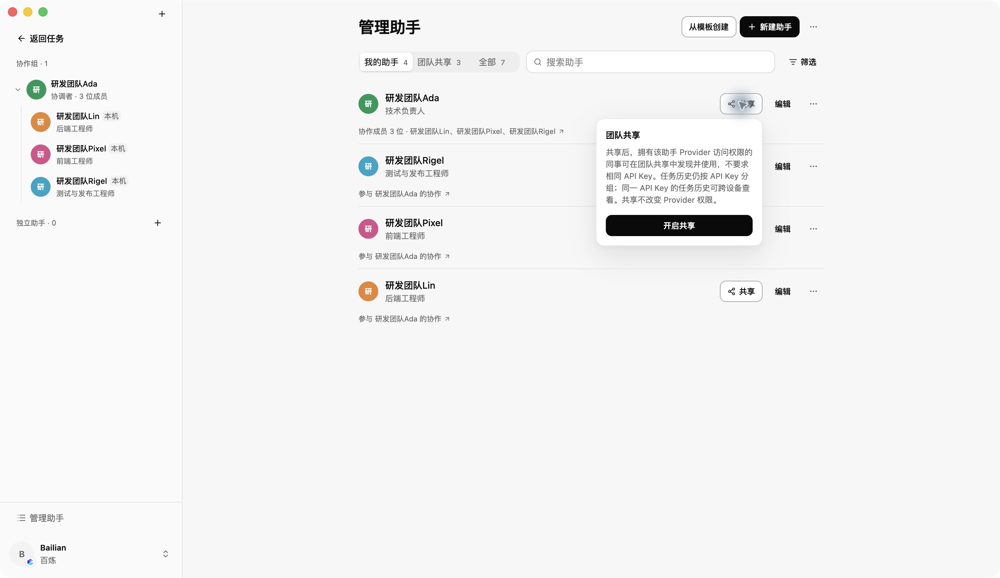
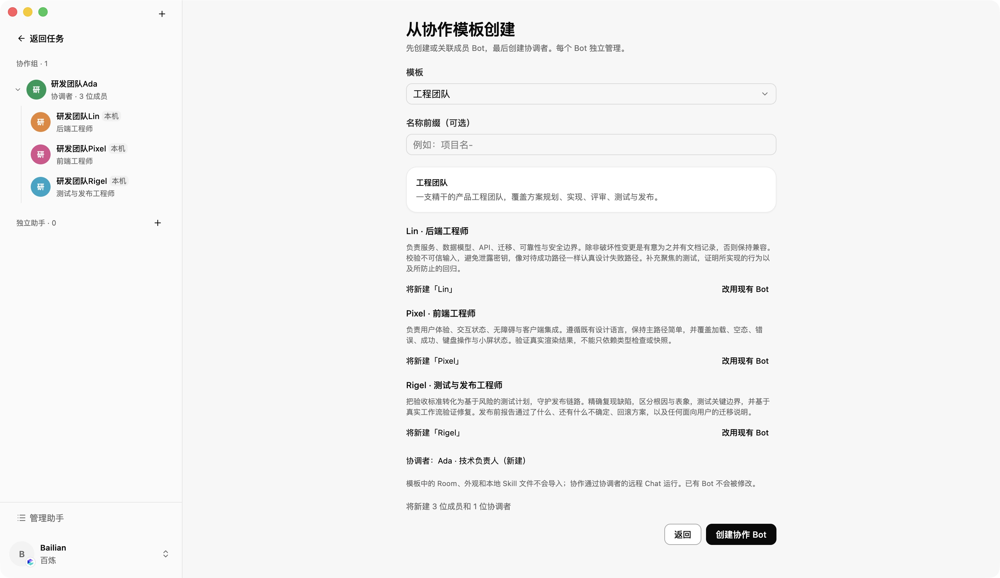
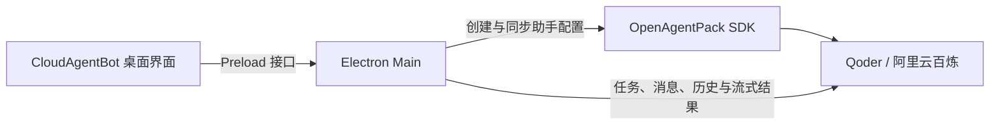

# CloudAgentBot

CloudAgentBot 是用于创建、使用和共享远程 AI 助手的开源桌面客户端，支持 Qoder 和阿里云百炼。

为助手配置工作指令、模型、工具和技能，然后使用助手处理任务。需要协作时，可以选择已有助手作为协作成员，也可以从预置模板创建。在 Provider 授权范围内，可以共享助手供同事复用，也可以共享任务供同事查看和继续处理。

项目处于早期开发阶段，当前通过源码启动，尚不提供已签名的正式发行安装包。



从新任务入口选择助手、描述任务并添加附件。以下截图取自本地运行的 macOS 应用。

## 主要功能

- **配置助手**：创建助手，设置职责描述、工作指令、模型和内置工具。修改配置后，将配置同步到 Provider。
- **使用技能与工具**：从「我的 Skills」或技能广场选择技能。百炼助手还可以选择官方 MCP 服务及其工具。
- **处理任务**：选择助手后发送任务，上传附件，查看流式回复、工具调用和产物。文件支持范围取决于 Provider；部分产物可以在应用内预览。
- **配置协作**：选择同一连接下的已有助手作为协作成员，或使用工程、营销、跟进和 SEO 等预置模板。任务页展示 Provider 返回的协作工作记录。
- **团队复用**：共享助手，让同事使用同一助手创建任务。也可以单独共享某个任务，让同事查看并继续处理。

本文使用「助手」指 Bot，使用「任务」指 Chat。助手对应 Provider 中的远程 Agent，任务对应远程 Session。Provider 是提供远程执行能力的云端服务。

### 助手管理

在同一页面查看助手职责、协作成员和共享入口。



### 技能选择

在助手配置中打开技能选择器，浏览当前 Provider 的技能广场。



## 支持范围

### Provider

| Provider   | 连接要求                                        | 当前差异                                                            |
| ---------- | ----------------------------------------------- | ------------------------------------------------------------------- |
| Qoder      | 可访问 Cloud Agents 的账号与个人访问令牌（PAT） | 创建助手时自动选择模型，创建后可调整；当前不提供 MCP 配置入口       |
| 阿里云百炼 | 国内站北京地域的 AgentStudio 资源权限           | 支持浏览器登录或手动填写 API Key 与 Workspace ID；支持官方 MCP 配置 |

百炼浏览器登录为实验性入口。登录不可用时，可以改用手动连接。

### 操作系统

| 平台                         | 验证状态                                 |
| ---------------------------- | ---------------------------------------- |
| macOS Apple Silicon（arm64） | 已完成本地验收                           |
| Linux                        | 已有打包配置与验收脚本，尚未完成实机验证 |
| Windows、macOS Intel         | 尚未验证                                 |

平台状态依据仓库中的验收记录，不表示已经提供对应平台的正式安装包。

## 快速开始

### 1. 启动应用

准备 Node.js 22.12 或更高版本，以及 `pnpm@10.33.0`。CI 使用 Node.js 22.23.2。

在独立克隆的仓库根目录安装依赖：

```bash
pnpm install --frozen-lockfile
```

启动桌面应用：

```bash
pnpm dev
```

开发启动不需要 `.env`。该文件仅用于显式启用的真实 Cloud 验证。运行本项目无需克隆 OpenAgentPack，也无需安装其 CLI 或配置父目录 workspace。

### 2. 添加连接



连接管理页提供添加连接、设置运行环境和更新凭据的入口。图中的 `ws-example` 是未保存的演示值。

在应用中打开「添加 Provider 连接」，选择 Provider。

- **Qoder**：填写个人访问令牌，获取方式见 [Qoder 快速开始](https://docs.qoder.com/cloud-agents/quickstart)。
- **百炼**：选择「百炼账号登录」，在系统浏览器中完成授权；或选择「手动输入 API Key」，填写 [API Key](https://help.aliyun.com/zh/model-studio/get-api-key) 和 [Workspace ID](https://help.aliyun.com/zh/model-studio/obtain-the-app-id-and-workspace-id)。

凭据验证成功后，应用检查可用运行环境。如果应用要求选择环境，选择一个环境并完成设置。设置失败时，连接仍会保留，可以在连接设置中重试。环境设置完成后，才能创建助手或任务。

### 3. 选择或创建助手

打开「新任务」，从助手选择器中选择一个助手。选择器默认显示「团队共享」，也可以切换到「我的助手」。

没有可用助手时，选择「创建助手」。填写名称，并按用途填写职责描述和工作指令。例如：

- **名称**：会议纪要助手。
- **职责描述**：将会议记录整理为决策和待办。
- **工作指令**：根据提供的会议记录，分别列出决策、待办和待确认事项。待办应包含负责人和截止日期。记录未提供的信息标为「待确认」，不要补充事实。

下面展示填写上述示例后的创建表单，尚未提交创建。



创建成功后，在「新任务」中选择这个助手。

### 4. 发送第一个任务

在输入框中描述任务。例如，粘贴一段会议记录，并输入「请整理这段会议记录」。需要提供文件时，可以添加附件。

选择「发送任务」。应用创建远程任务，并显示 Provider 返回的回复与工作记录。任务完成后，检查回复；如果任务生成了产物，可以打开产物查看。

后续可以从任务列表打开已有任务，查看历史并继续发送消息。

关闭主窗口后，应用继续在系统托盘运行。要完全退出应用，选择托盘菜单中的「退出」。

## 团队复用

### 共享助手

共享助手适合让同事使用相同配置处理各自的任务。

1. 在「管理助手」中打开本机受管理的助手。
2. 完成一次实际任务，确认助手适合预期用途。
3. 打开「共享」，选择「开启共享」。
4. 同事在对应连接中刷新助手列表，从「团队共享」选择助手并创建任务。

同事可以使用不同的 API Key，但必须具有对应的 Provider 资源访问权限。共享标记不授予或撤销 Provider 权限，也不会自动共享已有任务。

只有持有完整本地管理资料的客户端才能修改和同步助手配置。接收方无需导入这些资料即可使用助手。配置更新后，新建任务使用新配置，已有任务保持创建时的配置。操作说明见[共享助手使用指南](docs/bot-sharing-guide.md)。



### 共享任务

共享任务适合让同事查看并继续已有工作。

在自己所属 API Key 范围的任务中打开「共享任务」，选择「开启共享」。具有对应 Provider 访问权限的同事可以查看并继续该任务，但不能修改其共享状态、归档或删除该任务。

助手共享与任务共享相互独立。取消助手共享不会自动取消任务共享。应用内的 API Key 分组不替代 Provider 访问控制。

### 使用协作助手

在助手配置中添加协作成员，或选择「从协作模板创建」。模板可以创建成员，也可以引用已有助手；每个助手独立管理。模板目录中的本地 Skill 文件不会自动导入。



将任务发送给协调助手后，由 Provider 执行委派。消息中点名成员可以影响协调助手的选择，但不保证精确路由。任务页中的协作记录来自 Provider 返回的事件。

## 开发与验证

### 项目架构



CloudAgentBot 使用 OpenAgentPack SDK 管理远程助手配置，并直接调用 Provider API 处理任务与消息。SDK 通过固定版本的 npm 依赖引入。

项目使用 Electron、React、TypeScript 和 Tailwind CSS，UI Primitive 采用 shadcn/ui 模式。Renderer 负责交互，Electron Main 负责凭据、配置同步和 Provider 请求。任务执行与历史由 Provider 管理；本地保存连接及受管理助手的配置资料。

### 检查与打包

| 命令                            | 用途                                      |
| ------------------------------- | ----------------------------------------- |
| `pnpm typecheck`                | 检查 TypeScript 类型                      |
| `pnpm lint`                     | 检查代码规范                              |
| `pnpm test`                     | 运行测试，真实 Cloud 测试默认跳过         |
| `pnpm test:arch`                | 检查架构依赖边界                          |
| `pnpm package`                  | 构建并打包应用                            |
| `OPENAGENTBOT_LIVE=0 pnpm gate` | 运行完整本地门禁，显式关闭真实 Cloud 测试 |

完整门禁包含构建、打包和隔离的 Electron 验收，需要可运行桌面应用的环境。当前打包产物为 macOS 和 Linux 的应用目录。真实 Cloud 验证需要单独启用，方法见[验收说明](docs/validation.md)。

GitHub CI 使用 macOS arm64 作业运行同一条 `pnpm gate`，并显式关闭 Cloud 测试。该作业无需 Provider Key 或签名凭据。`pnpm format:check` 暂未纳入门禁，现有格式差异仍待整理。

升级 SDK 时，同步更新 `package.json` 与 `pnpm-lock.yaml`，然后执行完整本地门禁。

### 贡献与反馈

普通贡献不需要真实云端账号。Cloud 验证由维护者按验收说明显式执行。

1. Fork 仓库后创建分支。
2. 使用 `pnpm dev` 进行开发。
3. 提交前运行 `OPENAGENTBOT_LIVE=0 pnpm gate`。
4. 在 PR 中说明解决的问题与验证结果。涉及 UI 改动时，附上脱敏截图。

问题和建议请提交到 [Issues](https://github.com/heimanba/OpenAgentBot/issues)，并提供操作系统、架构、应用版本或 commit、复现步骤与预期行为。不要上传凭据、完整本地数据目录或真实聊天内容。安全问题请按[安全报告说明](SECURITY.md)私密反馈。

Electron 运行时升级及依赖告警尚待独立处理，需在正式安装包发布前完成，详见[检查记录](docs/validation-records/open-source-readiness-2026-10-03.md)。

## 项目文档

| 用途                           | 文档                                                             |
| ------------------------------ | ---------------------------------------------------------------- |
| 使用共享助手                   | [共享指南](docs/bot-sharing-guide.md)                            |
| 理解产品对象与身份规则         | [领域词汇](CONTEXT.md)                                           |
| 理解设计决策                   | [架构决策记录](docs/adr/)                                        |
| 理解进程与模块分工             | [项目架构](docs/architecture.md)                                 |
| 定位源码与测试                 | [目录规则](docs/repository-layout.md)                            |
| 理解本地配置与恢复规则         | [本地存储](docs/local-storage.md)                                |
| 查看模块与进程接口             | [接口说明](docs/interfaces.md)                                   |
| 执行本地与 Cloud 验证          | [验收说明](docs/validation.md)                                   |
| 查阅 Provider 合同与已执行验证 | [研究资料](docs/research/)、[验收记录](docs/validation-records/) |

开发计划记录当时的方案和未完成项，不覆盖现行规范。

## 许可证

本项目采用 [Apache License 2.0](LICENSE)。复制使用的第三方组件许可见[第三方声明](THIRD_PARTY_NOTICES.txt)，依赖包沿用各自许可证。

应用图标、托盘图标及仓库中的 Provider SVG 由项目作者自行绘制；Provider 名称及相关商标归各自权利人所有，展示不表示官方背书。
